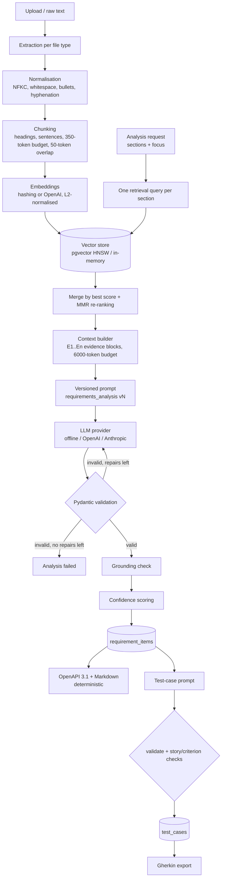

# AI design

This document explains how the service turns requirement documents into structured
artefacts, and the controls that keep model output trustworthy, auditable and affordable.

## 1. Pipeline



AI is used only where it adds value (reading prose and producing structured artefacts).
Everything that can be deterministic is: extraction, chunking, retrieval maths, grounding,
confidence, OpenAPI/Markdown/Gherkin generation, cost accounting.

## 2. Chunking and token estimation

* Tokens are estimated as `ceil(len(text) / 4)` (no tokenizer download, model-agnostic). The
  4-chars-per-token rule is a reasonable average for English prose on GPT/Claude tokenizers; it
  under-counts dense JSON/code, so budgets leave headroom (`ANALYSIS_CONTEXT_TOKENS=6000` is
  far below current context windows; in the captured sample run the instructions + JSON
  schema added about 4.1k tokens on top of 1.9k tokens of evidence).
* Units are headings and sentences (list items and paragraphs split on sentence boundaries,
  with an abbreviation list); an over-long sentence becomes word windows sized to 80% of the
  budget so a heading can stay attached.
* A heading always starts a new chunk, so a chunk never mixes sections. Within a section,
  chunks overlap by up to `CHUNK_OVERLAP_TOKENS` of trailing sentences. Each chunk is a
  contiguous span of the normalised text (`char_start`/`char_end`), which keeps citations
  exact.
* The text embedded for a chunk is `section path + chunk text`, so a chunk that continues a
  section after an overlap boundary still carries its topic.

## 3. Retrieval

* `POST /search`: embed query -> vector search with over-fetch (`top_k * 4`) -> hydrate (only
  chunks of `ready` documents) -> MMR (`lambda = 0.7` by default) -> top-k.
* Analyses use **multi-query retrieval**: one query per requested section (functional,
  non-functional, stories, entities, endpoints, tasks) plus the caller's optional focus. Hits
  are merged by best score per chunk and MMR runs over the union with the best score as
  relevance. This covers the corpus far better than a single query, and MMR stops overlapping
  chunks from crowding out the evidence set.
* A similarity floor (`ANALYSIS_MIN_SCORE`) drops irrelevant chunks. It is low by default
  because hashing-embedding cosine values are small in absolute terms.

## 4. Prompting strategy

Prompt templates live in `src/requirements_agent/ai/prompts/<name>/v<N>.md` and are seeded into
`prompt_templates` at startup. Each template has a `<<<SYSTEM>>>` and `<<<USER>>>` part with
`$placeholders` (`string.Template`, so JSON braces need no escaping). The system part:

1. sets the role (senior BA / architect, or QA engineer for test cases);
2. states the grounding contract: use only the evidence blocks, cite handles, omit
   unsupported items, put ambiguities in `openQuestions` instead of guessing;
3. defines conventions (id formats, MoSCoW priorities, REST resource naming, snake_case
   fields, PascalCase entities) so the output is consistent across runs and providers;
4. embeds the JSON Schema generated from the Pydantic models.

The user part carries the project name, requested sections, focus, the list of valid evidence
handles and the evidence blocks themselves:

```text
[E3] chunk=5f1c... | doc="field-service-work-orders.md" | section="... > 2.2 Scheduling and dispatch" | score=0.412
- The system shall allow dispatchers to assign work orders to technicians based on skills ...
```

Models cite the short handle (`E3`), which LLMs copy far more reliably than UUIDs; grounding
maps handles back to chunk ids.

**Versioning.** Admins create versions through `POST /api/prompts/{name}/versions` (validated:
both markers present, all required placeholders used, no unknown placeholders, valid `$`
syntax) and activate one with `POST /api/prompts/{name}/versions/{v}/activate`. A partial unique
index guarantees one active version per name. Seeded versions are immutable (checksum
mismatch is logged, the DB copy wins). Every analysis and every test case stores the prompt
name + version it used, and every `ai_usage` row records it too, so quality and cost can be
compared per prompt version.

## 5. Structured output and validation

* Schemas: `AnalysisOutput` (functional/non-functional requirements, user stories with
  Given/When/Then criteria, entities with typed fields and relationships, endpoints with
  request/response models, tasks, open questions) and `TestCaseGenerationOutput`.
* `extra="forbid"` everywhere: unknown fields are validation errors, not silently ignored.
  Ids follow patterns (`FR-001`, `US-001`, ...), field names must be snake_case, entity names
  PascalCase, paths lowercase with `{param}` segments, methods/categories/priorities are enums.
* Model-reported `confidence` is clipped into `[0, 1]` instead of being rejected.
* Remote providers run in JSON mode (`response_format=json_object` for OpenAI; instruction +
  extraction for Anthropic). Strict schema modes were not used because they require every
  property to be required; validation is enforced on our side regardless.

**Repair loop** (`ai/structured.py`): parse (tolerating code fences and leading prose) ->
validate -> on failure append the model's answer and the exact error list
(`userStories.0.acceptanceCriteria: Field required`, max 20 lines) and ask for a corrected
object. At most `STRUCTURED_MAX_REPAIRS` (default 2) repairs, then the analysis fails with the
first errors in `errorMessage`. Transport retries (timeouts, 429, 5xx) are separate and happen
inside the provider with exponential backoff and jitter; 4xx errors are never retried.

## 6. Grounding (hallucination mitigation)

Implemented in `ai/grounding.py`, applied to every validated output:

| Check | Action |
| --- | --- |
| Citation is not a provided handle or chunk id | Stripped; recorded under `unknownCitations` |
| FR / NFR / user story with no valid citation | **Dropped**; recorded under `dropped` |
| Entity / endpoint / task with no valid citation | Kept, `grounded=false`, issue recorded, confidence halved |
| Duplicate id (`FR-001` twice, same `METHOD path` twice) | Later duplicates dropped |
| Story -> unknown requirement id; endpoint -> unknown entity model or story; entity relationship -> unknown entity; task -> unknown dependency/item | Reference removed; recorded under `removedReferences` |
| Test case -> unknown story or criterion index out of range | Test case dropped; returned in `dropped` |

The grounding report is stored on the analysis and returned by `GET /api/analyses/{id}`.

## 7. Confidence scoring

```
confidence = clip01( (0.35 * R + 0.35 * S + 0.30 * M) * P_repair * G )
```

| Term | Meaning |
| --- | --- |
| `R` retrieval strength | mean similarity of the item's cited blocks / best similarity in the evidence set (relative, so it works for any embedder) |
| `S` lexical support (evidence coverage) | share of the item's content terms (stop words removed, 5-char prefix match) found in its cited evidence; low when an item says things its citations do not |
| `M` model confidence | the model's self-reported value, clipped to [0, 1] |
| `P_repair` | `max(0.5, 1 - 0.15 * repairs)` - output that needed repairs is trusted less |
| `G` | 1.0 grounded, 0.5 kept-but-uncited |

Every item stores the breakdown (`confidenceBreakdown`), and the analysis stores the mean.
This is a **triage signal** to sort review work, not a calibrated probability. Calibrating it
against human review labels is listed under future work.

## 8. Providers

| Setting | Implementation | Notes |
| --- | --- | --- |
| `LLM_PROVIDER=offline` (default) | `OfflineHeuristicProvider` | Deterministic rules, no network, schema-valid output with citations |
| `LLM_PROVIDER=openai` | `OpenAIProvider` (`OPENAI_MODEL`, default `gpt-4o-mini`) | Optional extra `.[openai]`, imported lazily |
| `LLM_PROVIDER=anthropic` | `AnthropicProvider` (`ANTHROPIC_MODEL`, default `claude-sonnet-4-5`) | Optional extra `.[anthropic]`, imported lazily |
| `EMBEDDING_PROVIDER=hashing` (default) | Feature hashing of unigrams, bigrams and char trigrams into 384 dims, signed buckets, L2-normalised | Lexical only |
| `EMBEDDING_PROVIDER=openai` | `text-embedding-3-small` with `dimensions=EMBEDDING_DIMENSION` | Keeps the pgvector column width fixed |

### What the offline provider is (and is not)

It is a rule-based analyser that reads the same evidence blocks an LLM would receive, through
the same provider interface, and emits the same JSON. It exists so the whole pipeline -
validation, grounding, scoring, persistence, generators - runs and is testable without keys.
Its rules: modal verbs (`shall/must/should/will/may/can`) -> functional requirements with
MoSCoW priority; quality keywords (performance, security, availability, scalability,
usability, reliability, maintainability, compliance) and number+unit metrics -> NFRs;
`As a ..., I want ..., so that ...` -> stories, nearby `Given/When/Then` lines -> criteria;
actor patterns (`Dispatchers shall be able to X`, `The system shall allow approvers to X`) ->
derived stories with one template-based criterion; `<Thing> has/includes a, b and c` ->
entities with types inferred from field names and enum values from parentheses; verbs applied
to entities -> REST endpoints; vague words (`fast`, `user-friendly`, `TBD`) and open-issue
sections -> open questions.

Known limits: no synonyms or coreference, no implicit requirements, template-like acceptance
criteria for derived stories, entity detection depends on "has/includes" phrasing. Its
`confidence` values are rule-strength constants, not probabilities. Use a real LLM for real
analysis.

## 9. Cost and token control

* Every AI call (chat and embedding, including failed attempts) writes an `ai_usage` row:
  provider, model, prompt name/version, input/output tokens (provider-reported when
  available, otherwise estimated), estimated USD cost, latency, success, error type, attempt,
  and project/analysis/user ids. **No prompt or document text is stored or logged.**
* Cost = tokens x a configurable price table (`AI_PRICE_TABLE`, USD per 1K tokens, merged over
  defaults). Prices are estimates; verify against the provider's price list.
* `GET /api/ai/usage` aggregates calls, failures, tokens, cost and average latency by
  operation, provider, model and prompt version (filters: `since`, `until`, `projectId`).
* Controls: context budget (`ANALYSIS_CONTEXT_TOKENS`), evidence cap (`ANALYSIS_MAX_EVIDENCE`),
  output cap (`LLM_MAX_OUTPUT_TOKENS`), bounded repairs, a per-user token bucket on generation
  endpoints (`RATE_LIMIT_AI_CAPACITY`, `RATE_LIMIT_AI_REFILL_PER_MINUTE`), and low temperature
  (`LLM_TEMPERATURE=0.1`) for reproducibility.

## 10. Failure modes and mitigations

| Failure mode | Mitigation |
| --- | --- |
| Model invents requirements not in the source | Citation requirement + grounding drop + lexical support term in confidence |
| Model cites evidence it was never shown | Unknown citations stripped and reported |
| Model output drifts from the schema | `extra="forbid"`, enums/patterns, repair loop with exact errors, bounded retries |
| Inconsistent cross-references (story -> missing FR, endpoint -> missing model) | Reference integrity pass; OpenAPI builder also falls back to generic objects with a warning |
| Retrieval misses relevant sections | Multi-query retrieval per section + MMR diversity; `focus` steering; small corpora are effectively fully retrieved |
| Overlapping chunks crowd the context | MMR redundancy penalty |
| Long documents exceed the context | Evidence capped by count and token budget; skipped blocks reported (`skippedForBudget`) |
| Provider outage / throttling | Retries with backoff for transient errors; analysis fails cleanly otherwise; usage row records the error type |
| Runaway cost | Rate limiting, budgets, usage reporting per prompt version |
| Prompt regression after an edit | Versioned prompts, activation is explicit, results record the version used |
| Sensitive content leaking into logs | Only ids/counts/types are logged; usage rows contain no text |
