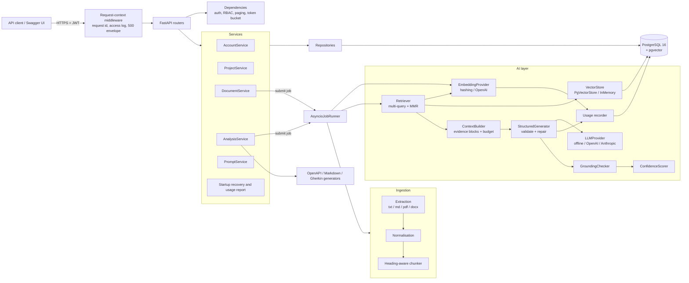
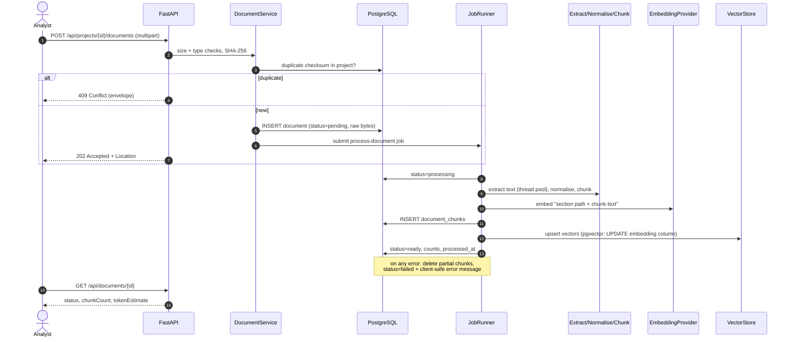
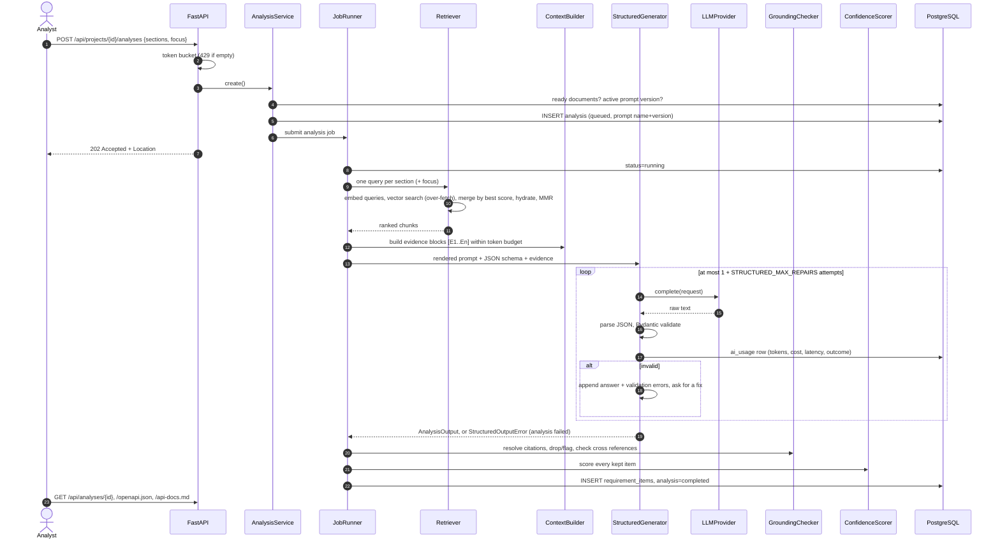
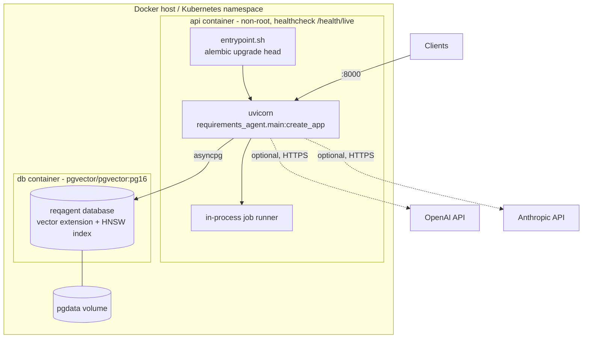
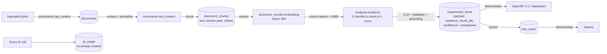

# Architecture

AI Requirements Agent is a single FastAPI service backed by PostgreSQL + pgvector. It is
structured in layers with dependencies pointing inwards; everything that talks to an external
system (database, LLM, embedding API) sits behind a small protocol so it can be swapped or
faked in tests.

| Layer | Package | Responsibility |
| --- | --- | --- |
| API | `api/` | Routers, dependency injection, auth/RBAC, paging, rate limiting |
| Schemas | `schemas/` | Pydantic DTOs (camelCase on the wire), envelope, pagination |
| Services | `services/` | Use cases and transactions; background jobs; composition root |
| Domain | `domain/` | Enumerations shared by every layer (roles, statuses, sections) |
| Repositories | `repositories/` | SQLAlchemy queries per aggregate (no commits) |
| Ingestion | `ingestion/` | Extraction, normalisation, token estimation, chunking |
| AI | `ai/` | Embeddings, vector stores, retrieval, prompts, providers, structured output, grounding, confidence, usage |
| Generators | `generators/` | Deterministic OpenAPI 3.1, Markdown and Gherkin builders |
| Core | `core/` | Settings, logging, errors, middleware, security, rate limiter |
| DB | `db/` | ORM models, portable column types, session, Alembic migrations |

## Component diagram

## Document ingestion sequence

## Analysis sequence

## Deployment

`docker compose up --build` starts both containers; the API waits for the database
healthcheck, applies migrations, then serves on port 8000. With the default `offline` and
`hashing` providers there are no outbound calls at all.

## Data flow and storage

Key properties:

* **Traceability end to end.** Every requirement item stores the chunk ids it was derived
  from; chunks store character offsets into the normalised document text; OpenAPI operations
  carry `x-evidence`. A reviewer can go from an endpoint suggestion back to the sentence that
  motivated it.
* **State lives in the database.** Jobs receive ids only; document and analysis status
  columns are the source of truth, which makes restarts recoverable (see below) and makes it
  straightforward to move jobs to an external queue later.
* **No raw content in logs.** Logs carry ids, counts, token estimates and error types.

## Failure handling

| Situation | Behaviour |
| --- | --- |
| Corrupt / encrypted / scanned PDF, empty DOCX | Document `failed` with a specific message; partial chunks removed |
| Unexpected error while processing | Document `failed` with a generic message; stack trace only in logs |
| Model returns invalid JSON / schema violations | Bounded repair loop; then analysis `failed` with the first validation errors |
| Provider timeout / 429 / 5xx | Retried with exponential backoff and jitter inside the provider (tenacity) |
| Provider 4xx (bad key, bad request) | Not retried; analysis `failed` with the error type |
| Process restart | Startup marks `queued`/`running` analyses `failed` (inputs may have changed) and re-queues `pending`/`processing` documents; the in-memory vector index is rebuilt from persisted chunks |
| Database down | `/health/ready` returns 503; requests fail with the 500 envelope |
